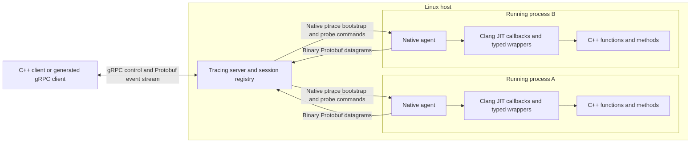

# Clang Tracer

Licensed under [Apache 2.0 with LLVM exceptions](LICENSE)
(`Apache-2.0 WITH LLVM-exception`). Dependency notices retain their original terms.

Build instructions, runnable callbacks and sample output are included below.
Generated validation recordings stay local; see [validation and benchmark notes](docs/validation.md)
for measured results and reproduction commands.

A native C++ server that attaches to multiple running Linux processes, installs
multiple probes per process, and streams binary Protobuf events over gRPC.
Worker threads may call traced functions and methods concurrently.
Clang's embedded Interpreter compiles both user callbacks and typed native entry
wrappers inside each target. Linux APIs perform attachment, loading, patching,
and restoration; LLVM MC validates the displaced instructions.

The runtime has three executables/artifacts: `clang-tracer-server`, the
`clang-tracer` gRPC client, and `libclang_tracer_agent.so`. gRPC and Protobuf are
communication dependencies. Instrumentation uses Clang/LLVM and native OS APIs.
All control responses and trace events use Protobuf.



Client communication is gRPC. The agent's local event channel carries the same
serialized `TraceEvent` Protobuf message over a nonblocking Unix datagram socket.
Native bootstrap commands use the shared request ABI through `ptrace`. This keeps
gRPC worker threads out of the injected target; no event is encoded as JSON.
The native request ABI is version 13 (binary Protobuf probe payload, prepare,
then controller commit); the public event protocol remains version 2. Earlier
agents reject the new native request before interpreting its payload.

## Buffered event delivery

Traced calls enqueue owned binary events into a bounded 4,096-slot queue; a
background sender retries congested sockets. Callers never wait for transport
readiness or queue capacity. Full queues and permanent send failures remain
counted drops. Successful remove/detach drains the sender and confirms server
publication before unregistering probes. See the `stack-capture-results/2026-10-30-buffered/report.md` (local recording).

The `stack-capture-results/2026-10-30-stack-fast/report.md` (local recording)
reduced the same benchmark's stack-enabled median from 127.269 to 95.210 us per
call while retaining zero event loss and identical frame metadata.

The `stack-capture-results/2026-10-30-stack-profiled/report.md` (local recording)
reduced a fresh baseline from 93.279 to 89.162 us/call (4.41% less time), with
zero losses. Every capture still reads current mappings; stream reuse and
sparse CFI plans reduce repeated work without transport or pool-capacity waits.

The `stack-capture-results/2026-10-30-mapread/report.md` (local recording)
batched fresh reads into fewer syscalls (5 -> 2 per capture on the measured
kernel). The same benchmark measured 92.094 -> 85.582 us/call with zero loss.
Parsed mappings are still refreshed on every capture.

A `stack-capture-results/2026-10-30-positioned-maps/report.md` (local recording)
removed a seek but showed no reliable whole-call speedup in interleaved runs.
The candidate was reverted; the production implementation above is unchanged.

## Optional values in stack callback output

The symbolized example can print named arguments in PRE and the original return
value in POST alongside its stack. Both preferences are **false by default**:

```sh
./build/clang-tracer trace "$PID" 'stack_add(int, int)' \
  --callback examples/call-stacks/symbolized.cpp \
  --callback-print-arguments true --callback-print-result true
```

The switches are independent and accept `true` or `false`. They configure
`call.print_options().arguments` and `.result`; the example checks the former
only in PRE and the latter only in POST. These preferences control the callback's
optional text lines; the existing captured Protobuf values and normal CLI event
fields remain available. Application-only stack filtering stays true by default.

Generic callback readers can use `call.argument_count()`, `argument_name(i)`,
`argument_value(i)` and POST-only `result_value()` without spelling the target's
ABI types. Values retain their `ValueType` tag. Missing names fall back to
`arg0`..`arg7`. Names and value references are read-only invocation views.
The example formats supported scalar types and void results; pointers and
by-value objects print their captured addresses without dereferencing objects
or invoking target formatting methods. Existing typed argument/result accessors
remain available for custom callbacks. See `stack-capture-results/2026-10-30-optional-values/report.md` (local recording).

## Native call stacks

Add `--stack 24` to an ordinary `trace` command to capture the calling thread's
entry stack, with a depth from 1 to 64. Capture is optional. An interceptor may
also call `call.capture_stack(24)` without that flag; `call.stack()` reads the
automatic snapshot. Both PRE and POST refer to the invocation's entry stack.
Stacks are application-only by default in both callbacks and CLI output.
`--stack-application-only false` restores all native, JIT and runtime frames;
`true` explicitly selects the default. Callback-requested capture inherits this
probe setting, or can override it with `call.capture_stack(24, false)` for all
frames (`true` for application-only). `call.stack()` reads the resulting view.
The filter removes tracer/JIT bridges, runtime modules and standard-library
declarations, including standard templates instantiated inside the executable.
Application functions taking `std::` arguments remain visible. ELF ownership,
SONAME and LLVM declaration context drive classification, not a substring match
on parameter types.

Filtering happens after the bounded native unwind: requested depth includes
hidden frames, and COMPLETE/PARTIAL/TRUNCATED continues to describe that unwind.
`stack.captured_depth` records raw depth and `stack.hidden_frames` records the
omissions; the CLI prints both. Filtering never turns a truncated unwind into
a complete one. A fully hidden snapshot may contain zero visible frames.
The corresponding Protobuf fields preserve the same callback/CLI view.

Callbacks can inspect the bounded frame array (`pc`, `stack_pointer`, `kind`,
`function`, `module`, `file`, `line`, `module_offset`, `application_frame`), frame count, requested
depth, status and stop reason. LLVM resolves metadata before PRE/POST can read
it; events reuse the exact same snapshot. `function`, `module`, and `file` are
agent-owned immutable C strings, limited to 256 bytes; empty means unknown and
line 0 means unavailable. Use these views within the invocation and do not free
or modify them. Symbolization failure does not change unwind completeness.

The [symbolized callback](examples/call-stacks/symbolized.cpp) loops over every
frame in both hooks and prints function/module/source/line from `call.stack()`.
It uses automatic capture when `--stack` is present and requests capture itself
otherwise. See `stack-capture-results/2026-10-30-application-only/report.md` (local recording).

```sh
./build/clang-tracer attach "$PID"
./build/clang-tracer trace "$PID" 'StackCalculator::multiply(int, int)' \
  --callback examples/call-stacks/method.cpp --stack 24
./build/clang-tracer trace "$PID" 'stack_add(int, int)' \
  --callback examples/call-stacks/function.cpp
./build/clang-tracer events "$PID" --count 24 --timeout 15
./build/clang-tracer detach "$PID"
```

The CLI prints `COMPLETE` when native CFI reaches a thread root, `TRUNCATED` when
the requested depth is exhausted, and `PARTIAL` with a reason when unwinding
cannot continue. Missing symbols leave raw PCs and module offsets readable;
symbol availability and unwind completeness are separate. `TARGET_ENTRY` marks
the selected function's logical entry (before the original call), `NATIVE`
marks recovered caller return PCs, and `JIT_BRIDGE` in full-stack mode marks an enclosing
tracer wrapper. Native helper/callback frames are omitted. A verified bridge uses
the live invocation's wrapper frame and exact generated call-site bounds;
anonymous JIT memory is never treated as target CFI.

LLVM parses `.eh_frame` and DWARF; native Linux memory reads stay within the
original readable stack mapping. Target frame pointers are optional. Initially
only caller RIP/RSP/RBP are known; register/expression rules requiring unavailable
state, signal frames, missing CFI, unreadable memory, changed ELF identity and
resource limits stop with `PARTIAL`. Inline and optimized-away calls are not
invented. A zero return PC or explicitly undefined return register terminates
the unwind. File-backed image caches use private byte copies to preserve the
existing admission and detach mapping checks. Capture performs bounded work on
the calling thread and can add latency; cached LLVM state is serialized across
threads. This does not expand the existing supported target ABI/layout rules.
Resolved frame metadata is cached immutably for at most 16,384 distinct ELF
lookup addresses, keeping per-call stack storage small and pointers stable
across concurrent captures and cache growth. If metadata cannot be resolved,
the raw frame remains available with empty strings and line 0.

The complete [call-stacks example](examples/call-stacks/README.md) includes a
three-thread target, a shared library, callbacks, copy-paste commands and recorded
CLI output. No target source, class copy, export, rebuild, relink or agent linkage
is needed to trace an existing supported debug binary.

## Build and run

Use Linux x86-64, C++20, matching LLVM/Clang development packages (21 or 22),
Protobuf with `protoc`, gRPC C++ with `grpc_cpp_plugin`, CMake, and Ninja.

```sh
cmake -S . -B build -G Ninja \
  -DCMAKE_BUILD_TYPE=RelWithDebInfo \
  -DCMAKE_C_COMPILER=clang -DCMAKE_CXX_COMPILER=clang++ \
  -DLLVM_DIR=/usr/lib64/llvm21/lib64/cmake/llvm \
  -DClang_DIR=/usr/lib64/cmake/clang
cmake --build build -j4
ctest --test-dir build --output-on-failure
```

Adjust package paths for your installation. CMake generates the C++ message and
service bindings from `proto/tracer.proto`; the agent links Protobuf without the
gRPC client/server library. The integration test uses real target processes and
real generated gRPC clients.

For RHEL-compatible systems, see [build, toolchain and deployment instructions](docs/build-rhel.md).
`build-rhel.sh` accepts custom compiler/LLVM paths or a CMake toolchain file;
`deploy-rhel.sh` installs the build or stages it with `DESTDIR`. Standard CMake
`CMAKE_INSTALL_PREFIX`, `CMAKE_INSTALL_BINDIR` and `CMAKE_INSTALL_LIBDIR` select
where the binaries and agent library go. Installed servers find their agent
automatically, and matching Clang builtin headers are bundled by default.
`TRACER_JIT_FLAGS` configures the embedded compiler's sysroot, standard-library
headers and other callback compiler defaults independently of the build compiler.

Start the server:

```sh
./build/clang-tracer-server --agent "$PWD/build/libclang_tracer_agent.so"
```

It prints its private Unix endpoint to stderr. To choose a stable endpoint:

```sh
mkdir -m 700 /tmp/my-clang-tracer
./build/clang-tracer-server \
  --agent "$PWD/build/libclang_tracer_agent.so" \
  --listen unix:///tmp/my-clang-tracer/control.sock --timeout 10
```

Use that endpoint in every client invocation. Existing socket paths are rejected;
Unix sockets are mode 0600. Explicit loopback TCP endpoints are also accepted.
This is a trusted local service; remote network exposure and authentication are
not implemented. Start two samples in separate terminals with
`./build/trace-target`; each prints its PID and normal call results.

The OS must permit attaching to those processes. No system tracing policy is
changed by this project. Linux ownership and
[Yama policy](https://www.kernel.org/doc/html/latest/admin-guide/LSM/Yama.html)
apply; matching user IDs alone may not suffice.

## gRPC API

The versioned package is `clangtracer.v1`. Generate clients from
[`proto/tracer.proto`](proto/tracer.proto) in any supported gRPC language.

| RPC | Result |
| --- | --- |
| `Attach(pid)` | Discovers and pins the process's eligible application DSOs, loads the agent, and returns a process session ID |
| `AddProbe(session_id, spec)` | Compiles a callback and installs one typed hook |
| `RemoveProbe(session_id, probe_id)` | Restores that entry, drains in-flight work, and returns counters |
| `Detach(session_id)` | Removes every probe from that process; other sessions continue |
| `ListSessions()` | Returns session state, probe metadata, and failures |
| `WatchEvents(session_ids, after_sequence)` | Streams Protobuf events, optionally filtered by process sessions |

The CLI attaches with only the target PID:

```sh
./build/clang-tracer attach PID
```

When `CLANG_TRACER_ENDPOINT` is unset, the CLI uses
`127.0.0.1:50051`; the server must listen on the matching endpoint. Set the
environment variable when using a Unix socket as shown below.

At attach, the server snapshots mapped, file-backed executable ELF DSOs with
supported DWARF CFI. It excludes the main executable, libc, the ELF `PT_INTERP`
loader, and known runtime, compiler, and tracer images using mapped file
identities plus SONAME/path guards. The snapshot is path-sorted and returned in
`Session.application_modules`; it stays fixed for that session. Attach field 2 is
reserved for wire compatibility; clients do not choose module paths.

The 256-candidate cap counts distinct absolute-path, file-backed executable
identities after excluding the main image and runtime identities recognized from
the current mappings. It is enforced before ELF, SONAME, and CFI eligibility
checks; an oversized set fails closed without truncation. Unreadable, non-`ET_DYN`,
known-runtime, or unsupported-CFI candidates are skipped. A later-loaded library
is outside the session snapshot; frames in it remain unavailable until a new
session discovers that image.

One session owns a PID at a time. A process start-time check protects against PID
reuse. Operations for one session are serialized; separate sessions can progress
independently. A detached live process can be attached again. Session IDs remain
available for status inspection. Session history is bounded to 64 entries per
server lifetime; the agent retains at most 32 prepared probe generations per
process lifetime.

The event history holds 4,096 messages. Each event has a server cursor, a per-probe
sequence, PID/TID, monotonic timestamp, probe/session IDs, typed arguments, a
method object address, callback value, phase, per-probe call ID, and loss counters.
POST events include the typed original result. A nonzero resume cursor
older than retained history receives `OUT_OF_RANGE`. A zero cursor starts with
available history. Slow subscribers do not block target threads; a full native
socket drops events, and sequence gaps expose that loss.

## C++ functions and methods

Trace a running process by C++ signature using its mapped ELF debug information:

```sh
./build/clang-tracer trace PID 'Calculator::multiply(int, int) const' \
  --callback examples/cpp-interceptors/method.cpp
```

No target source, compilation database, copied class, or handwritten symbol is
required. LLVM DWARF APIs discover the code entry/range, scalar ABI, parameter names,
receiver size, member offsets/types, and access. The agent independently rereads
its mapped debug images and checks image identity and metadata before constructing
Clang AST declarations. Clang verifies receiver size and every member offset and
size; mismatches fail before patching. Image identity includes device, inode,
size, modification and change times, and is checked before and after resolution.
Native patchability, admission, stopped-thread patching, and detach safeguards
remain in force. Inlined or optimized-away calls are not traceable entries. Class arguments are described below.

Use embedded DWARF (`-g`) in the executable or mapped application ELF libraries.
Runtime/compiler images are excluded; discovery is bounded to 256 images and
bounded DIE traversal. Debug-stripped binaries cannot provide typed discovery.
External debug-file lookup and split DWARF are not implemented. Missing or
unsupported information produces an error; target source is never a fallback.
The target and debug data must be Linux x86-64 LP64 with supported scalar ABI.

Named tracing requires no exported symbol or ELF symbol-table entry. LLVM reads
the concrete function's DWARF low/high PC range, then relocates its entry through
the image's executable ELF PT_LOAD segment and the target's executable mapping.
Device/inode and full debug-image identity must match; PIE, fixed-address
executables and shared libraries use the same translation. The agent independently
re-resolves the exact entry, range and callable metadata inside the target before
decoding or preparing a hook. A patch cannot extend beyond the selected function.
No target relinking or rebuilding is needed when supported DWARF is already
present. Missing concrete code ranges, ambiguous mappings and unpatchable entries
fail closed. Fragmented DWARF range lists are currently unsupported.

Normal CLI verification covered non-exported free functions and methods in
already-running PIE and fixed-address executables, plus a mapped shared library,
with the selected routines removed from both ELF symbol tables. PRE/POST fields,
results, binary hashes and successful detach were checked; see the
`typed-this-results/nonexported-2026-10-30/report.txt` (local recording).

Receiver support currently covers named non-template, non-nested class/struct
layouts with direct builtin scalar or builtin-pointer members and ordinary
alignment. Inheritance, virtual layout, bitfields, aggregate/array members,
constructors/destructors, variadics, and unsupported calling
conventions/types are rejected. Public/private/protected access comes from DWARF.
DWARF does not supply complete source semantics such as default initializers or
mutable declarations. Optional `--include /absolute/header.hpp` can enrich the
receiver declaration; its layout must still match DWARF. It is never required.
Ordinary helper `#include` directives may also be written in callback files.

For optional target headers, `--compdb build` or
`--compdb /path/to/compile_commands.json` supplies their original compiler flags,
include paths, defines, language version, target and working directory. Clang's
`inferMissingCompileCommands` selects a source entry using filename/directory
similarity; its selection is printed as `header_context`. Only the command is
borrowed: the donor `.cpp` is never parsed and need not exist. Clang parses a
synthetic translation unit containing only the requested header includes, using
a private filesystem so the target's working directory stays unchanged.

```sh
./build/clang-tracer trace PID 'total(Order&, double, const Coupon&, Order, int)' \
  --callback examples/order-arguments/interceptor.cpp \
  --include examples/order-arguments/order.hpp --compdb build
```

Without `--compdb`, Clang searches the first header's parent directories for a
database. If none exists, optional standalone headers use the default C++20
context. An explicit missing/empty database fails clearly. Multiple headers use
the first header's command; inspect the printed inference when build variants
or nearby sources use different flags. Output/dependency-generation flags and
the donor source input are removed. Supplied headers must be accessible in the
target filesystem and must still pass the DWARF layout/type checks. These flags
configure the header AST; callback compilation retains its C++20 context.

The raw exported-symbol interface with explicit `--return`/`--arg` remains
available. It does not provide a typed receiver. The CLI no longer accepts
`--source`. `--compdb` is optional and applies only with `--include`.

## DWARF-typed arguments

`call.argument<Index>()` gives typed access to any supported explicit argument
position without naming its C++ type or supplying class definitions. Scalars are
returned as values; class reference/pointer arguments expose const views of the
actual object, and supported by-value classes expose a const reference to the
wrapper's entry snapshot. That snapshot remains unchanged in POST when the callee
modifies its own copy. The original return value is separate. Argument views must
stay within the callback invocation.

The complete [Order argument example](examples/order-arguments/README.md) mixes
Order&, double, const Coupon&, by-value Order, int, and an Order* probe. For example:

```cpp
const auto& order = call.argument<0>();
auto fee = call.argument<1>();
call.field(order.quantity); // inferred order.quantity
call.field(fee);            // inferred fee
```

All record declarations are constructed from DWARF with Clang APIs, verified,
and imported into preflight/JIT. Member paths are scoped to the target argument,
so two Order instances can both publish quantity without duplicate labels.
By-value class arguments require explicit DWARF pass-by-value ABI evidence;
Clang performs aggregate argument lowering with the verified record layout.
Nontrivial/unsupported by-value ABIs and nonordinary alignments are rejected.
Flat scalar/pointer-member layout restrictions still apply. Optional headers are
not required. Existing argument<T>(index) and arg<T>(index) scalar access remains.
The Protobuf OBJECT value records an address of the wrapper's by-value snapshot;
member snapshots remain independent typed named values. Bootstrap ABI is 13.

## C++ interceptor

Callbacks can publish named argument values with
`call.argument<int>("value", 0)` and object-field snapshots with
`call.field("bias", call.self()->bias)`. Use void pre/post hooks when returning
no numeric callback value. The CLI prints names and typed values directly, with
POST's original result shown separately. Protobuf `TraceEvent.named_arguments`
(field 17) and `object_fields` (field 18) carry these values on both the local
agent channel and gRPC stream; the public event protocol remains version 2.
DWARF supplies parameter labels and Clang infers direct member labels; explicit labels remain supported. Snapshots are scoped to one hook
invocation, bounded to 16 values with 63-byte identifier names; duplicates and
invalid/overflowing captures raise a caught callback error. Named field values
support scalar integers, float/double, and pointers. Legacy numeric callbacks
remain supported. Server, agent and callback context must match bootstrap ABI 13.


A complete [method and free-function example](examples/cpp-interceptors/README.md)
includes a target program, interceptors capturing arguments and object fields,
and a runner:
`./examples/cpp-interceptors/run.sh` (Linux x86-64, after building the tracer).

Write a class named `Interceptor` in a callback file. For
`Fixture::overloaded(int)`, this records the argument before the call and its
result afterwards:

```cpp
class Interceptor {
public:
  long long pre(const Call& call) {
    return call.arg<int>(0);
  }
  long long post(const Call& call) {
    return call.result<int>();
  }
};
```

Load the file with the usual command:

```sh
./build/clang-tracer trace PID 'Fixture::overloaded(int)' \
  --callback interceptor.cpp
```

Clang compiles the class inside the target and generates the linkage bridge.
No `extern "C"`, registration macro, or include is needed in the file. The same
API is available to editors through `include/tracer/callback.hpp`.

`pre()` runs before the original call; `post()` runs after a normal return.
Either hook can be omitted. Hooks can return `void` or `long long`; an integer
return records `callback_value` in the event, while a void hook records zero.
It does not replace the application's return value. POST events also carry the
typed original result, including `VOID`. PRE and POST share a per-probe call ID
for correlation across concurrent calls. Transport loss or detach can leave a
pair incomplete; post is not called when the original function throws.

`call.arg<T>(index)` reads an argument and `call.result<T>()` reads the result
in post. Types must match the supported scalar ABI; invalid indices, types, or
reading a result in pre raise a caught callback error. `call.object_address()`
reports the method's object address, `call.probe_id()` identifies the probe,
and `call.id()` identifies this invocation. Do not retain the `Call` reference.

For a supported debug-selected method, `call.self()` returns a const-qualified
pointer to the Clang receiver type reconstructed from DWARF, preserving volatile
where known. No target translation unit is parsed or executed. POST reads the
same object's state after the original method returns. Argument zero is always
the first explicit parameter; parameter labels come automatically from DWARF.

Write `call.field(call.self()->bias)` to capture a field without a string label.
Clang inspects the callback's member/local-variable expression and inserts the inferred field path before
final validation/JIT compilation. Other expressions require the explicit
`field(name, value)` form. Member expressions inside macros are rejected for
inference. Use `call.argument<int>(0)` for checked access without a label; all
arguments are already captured and named by debug metadata. Explicit labels remain
available when desired. Arguments and fields together are bounded to 16 named
values. Ordinary C++ access and target lifetime/synchronization rules apply.
The validator rejects constructing/copying the receiver and calling its methods.

One interceptor instance belongs to each probe and is shared by calling
application threads. Keep hooks stateless or synchronize any shared members.
Clang checks the class and hook signatures before installation. Hook exceptions
disable the interceptor and increment its error counter. Reentry from a hook
suppresses nested hooks and events. Original results and errno are preserved.
Detach closes hook admission and drains calls already in flight; executable
wrappers remain resident for safe late arrivals.

The previous C++ function interface,
`extern "C" long long trace_callback(const TraceContext&)`, remains supported
for entry-only callbacks; `extern "C"` only specifies linkage. See
[`examples/trace_callback.cpp`](examples/trace_callback.cpp) for that interface
and [`examples/interceptor.cpp`](examples/interceptor.cpp) for the class API.
Source code is trusted native code: target memory faults are not isolated, and
initialization must avoid blocking, spawning threads, or changing loader/runtime
state during compilation.

## Client usage

The client presents readable text in the terminal; it still sends gRPC requests
and receives the same Protobuf messages. Start the server with a Unix endpoint:

```sh
mkdir -m 700 /tmp/my-clang-tracer
./build/clang-tracer-server --agent "$PWD/build/libclang_tracer_agent.so" \
  --listen unix:///tmp/my-clang-tracer/control.sock
```

In another terminal, save the endpoint so it does not need to be repeated:

```sh
export CLANG_TRACER_ENDPOINT=unix:///tmp/my-clang-tracer/control.sock
```

Start `./build/trace-target` and use the PID it prints. Attach and trace its
`Fixture::overloaded(int)` method with the callback file:

```sh
./build/clang-tracer attach PID
./build/clang-tracer trace PID 'Fixture::overloaded(int)' \
  --callback examples/trace_callback.cpp
```

`trace` prints the resolved declaration, linker symbol, and probe ID. The
callback returns `arg0 * 100 + 17`; the target method's own result is preserved.
To select the other overload, replace `(int)` with `(long)`. A free function can
be selected by name too:

```sh
./build/clang-tracer trace PID 'traced_work(int)' \
  --callback examples/trace_callback.cpp
```

Read events continuously (stop with Ctrl-C), or set a count or timeout:

```sh
./build/clang-tracer events PID
./build/clang-tracer events PID --count 10 --timeout 15
./build/clang-tracer events PID --after 100 --count 10
```

Remove one probe or detach all probes from the process:

```sh
./build/clang-tracer remove PID PROBE_ID
./build/clang-tracer detach PID
./build/clang-tracer list
```

The default output is readable text in the terminal. For scripts that need
machine-readable output, `--format protobuf` writes the existing four-byte
little-endian length-prefixed Protobuf frames; add `--output FILE` to save them
to a file instead of standard output. The legacy `--request` interface also
remains available and continues to use binary Protobuf output; neither changes
the gRPC or wire protocol. Canceling an event stream ends that subscription,
while probes keep running until removed or detached. SIGINT/SIGTERM shuts down
the server and attempts to restore active hooks.

## Backend limits and lifecycle

The native backend supports Linux x86-64 processes with concurrent application
threads, including a CPU-busy leader inside nested C++ functions and methods.
Admission no longer requires an instruction in `main`, a `main` symbol, or an
immediate return into libc. LLVM parses `.eh_frame` and unwinds each application
frame through executable segments of the main ELF image or a DSO in the session's
discovered snapshot, selecting the matching image and pinned load bias at each
frame. Executable and library symbols may be stripped; unwind metadata must
remain. The walk ends at libc's
identified `__libc_start_call_main` → `__libc_start_main` startup chain, whose
symbols are still required.

The complete chain is bounded to 128 frames including startup. Each recovered
stack pointer must advance within the original readable stack mapping, and saved
register reads are checked for bounds and overflow. The first PC is used exactly;
caller return PCs are adjusted to their call sites. Unsupported unwind rules,
signal frames, callbacks that unwind through protected runtimes, undiscovered
library frames, and incomplete or excessively deep chains are rejected and
retried within the operation deadline.

The session snapshot retains file handles and pins device/inode, size,
modification and change timestamps, and load bias. Every control attachment
revalidates each pinned path, open file, and target mapping before native
execution, including the sleep admission path. Replacement, modification,
unmapping, or rebasing invalidates the snapshot instead of approving a new image.
Module handles are released after logical detach or target exit; discovered-path
history remains visible. Concurrent module unloading and modification during an
operation remain outside the lifecycle contract.

This is a restricted application rendezvous, not arbitrary-PC injection. The
bounded startup-chain check does not prove arbitrary runtime or application lock
state is safe. The borrowed application thread must not retain locks needed by injected
code. Custom runtimes, nonlocal jumps, unusual initialization, signal frames, and
frames in unknown or unsupported shared libraries remain unavailable. A new
session takes a fresh snapshot for libraries loaded later; it does not make
unsupported CFI or runtime behavior safe.
The existing `nanosleep`/`clock_nanosleep` admission path remains available outside
critical sections, with its prior interrupted-sleep timing/restart limitation.
Native calls preserve general registers, extended floating-point state, the
thread's signal mask, and its `errno` value. Signals are blocked during injected
execution and the saved mask is restored before normal execution resumes.

The server seizes and stops every peer thread before changing executable bytes,
re-enumerating the task set until all current threads are accounted for. Exiting
threads are handled explicitly; a new thread discovered during the stop is also
stopped. A thread inside the bytes being replaced causes a bounded retry.
Expected bytes and committed bytes are verified, and failed writes are rolled
back while peers remain stopped. Unsupported job-control stops are rejected.
These operations use the OS's per-thread tracing interface
([Linux ptrace](https://man7.org/linux/man-pages/man2/ptrace.2.html)).

Peers run during agent loading and Clang compilation so a stopped peer cannot
hold a lock needed by the compiler or loader. Preparing a probe does not change
the target entry; the server commits the prepared jump in a separate all-thread
stop. Temporary bootstrap syscall instructions use the same stop discipline.
Each retained probe owns immutable event-session identity and its own socket;
callback recursion state is thread-local and counters are atomic. Callback source
must itself be thread-safe. Per-probe sequence values are unique, but concurrent
threads can deliver them out of order; server sequence records arrival order.

Only supported, complete prologue instructions are copied into the trampoline.
Branches, PC-relative operands, CET entries, and unsupported instructions are
rejected. The fixtures include selected optimized unwind cases; broader code
without supported CFI or complete prologues remains unsupported. Module unload,
signal handlers, allocator/runtime hooks, and unusual control transfers need
separate backend work. macOS and Windows backends are not implemented.

Removal restores the original entry under an all-thread stop, resumes peers,
closes callback admission, and waits for outstanding calls to finish. Sequentially
consistent admission and in-flight accounting prevent a callback from slipping
past a successful drain. The agent, JIT code, and trampolines remain resident
until process exit, including for a thread already redirected into a wrapper
before its counter increment; this is logical detach. Unsafe or uncertain
restoration parks the target and
reports a failed session. Shutdown cleanup failures are reported, not silently
claimed as success. Forced server termination has no automatic recovery protocol.
Concurrent `exec`, `fork`/`vfork`, unloading a probed module, external code patching,
signal-handler probes, and control threads holding application/runtime locks are
outside the current lifecycle contract.

## Validation and sources

Class-instance arguments verified on 30 October 2026 through the normal CLI,
with Order target source and compilation database temporarily unavailable.
Reference and pointer field changes, a by-value snapshot, two different class
types, all five mixed argument positions and original results matched the target
log. Both entries restored and the target progressed after detach with zero
result failures. No integration tests were run. See the
[Order example](examples/order-arguments/README.md) and
`typed-this-results/order-arguments-2026-10-30/direct-cli.txt` (local recording).


DWARF-only tracing verified on 30 October 2026 through the normal CLI with the
target source and compilation database temporarily unavailable and no includes
supplied. Six function and four method PRE/POST pairs had automatic parameter
names and inferred member labels; values matched the target log. Both entries
were restored, the target progressed after detach with `TracerPid=0`, and a
debug-stripped copy was explicitly rejected. No integration tests were run.
See the `typed-this-results/dwarf-only-2026-10-30/report.txt` (local recording)
and `typed-this-results/dwarf-only-2026-10-30/direct-cli.txt` (local recording).

Named values verified on 30 October 2026 through the normal CLI: six
free-function and four method PRE/POST pairs carried named typed arguments and
object-field snapshots matching the target log, with zero reported losses.
Both entries were restored on detach; the target continued from 8 to 14 calls
with `TracerPid=0`. No integration tests were run for this change. See the
`typed-this-results/named-values-2026-10-30/direct-cli.txt` (local recording)
and `typed-this-results/named-values-2026-10-30/report.txt` (local recording).

Typed receiver access verified on 29 October 2026: **14/14 Linux CTests passed
in 171.18 seconds**; the new typed-receiver test passed in 17.33 seconds.
`call.self()` reads original fields in PRE and POST, including their change
across the call, without copying the class. Private/const access checks,
copy/construction/method-call rejection, unsupported receivers, and pointee ABI
mismatch checks passed. An out-of-line method and a callback including standard
headers successfully read a `wchar_t*` field. The target's global initializer
ran once, active typed-probe detach preserved progress, and every earlier
threaded/busy/nested/shared-library regression passed. The standalone example
restored both entries and left its target alive. See the
`typed-this-results/report.txt` (local recording),
[actual example output](examples/cpp-interceptors/example-output.txt), and
`typed-this-results/ctest.log` (local recording).

C++ class interceptors verified on 29 October 2026: **13/13 CTests passed in
152.01 seconds**; the new class test passed in 30.90 seconds. Named method
tracing produced correlated PRE/POST events with correct arguments and original
results. Optional and void hooks, double/pointer access, malformed classes,
invalid typed access, and caught hook exceptions passed. Concurrent class hooks
traced functions and methods while the main thread remained busy; detach stopped
events, released traced threads, and preserved all four workers' progress and
results. The legacy callback and full native admission/shared-library suite also
passed. A direct CLI run recorded argument 3/result 14 and argument 4/result 15,
then restored the entry and left the target running. See the
`class-interceptor-results/report.txt` (local recording),
`class-interceptor-results/direct-cli.txt` (local recording), and
`class-interceptor-results/ctest.log` (local recording).

Clang-name resolution verified on 29 October 2026: **12/12 CTests passed in
70.91 seconds** on the Linux toolchain below; the new name-resolution test passed
in 3.60 seconds. Clang selected `Fixture::overloaded(int)`, the `long` overload,
and `Fixture::inspect(double) const` from the original source and inferred their
Protobuf signatures. The callback file produced correct typed values and object
addresses; removal and detach restored entries and preserved original results.
Ambiguous/missing names, wrong parameter lists, unsupported types, parse errors,
virtual overloads, qualifier mismatches, token-boundary collisions, and the x32
ABI were rejected before RPC. A separate direct CLI run also resolved the
C-linkage `traced_work(int)` function and traced it alongside the named method.
See `cpp-name-test-results/direct-cli.txt` (local recording),
`cpp-name-test-results/report.txt` (local recording), and
`cpp-name-test-results/ctest.log` (local recording).

Verified on 29 October 2026: **11/11 CTests passed in 72.60 seconds** on the
same Linux toolchain described below. The new direct CLI integration passed in
2.96 seconds; the legacy binary CLI test also passed. Coverage includes PID
session lookup, callback source files, free functions and C++ methods, typed
readable events, explicit binary output, cursor resumption, Ctrl-C cancellation
with probes still active, local input errors, removal, and active-probe detach.
The thread-churn test now tolerates a TID that demonstrably exited between task
enumeration and status reading, while still rejecting traced or unreadable live
threads and requiring at least five checked threads.

The direct shell commands were also run separately: both sample callables
produced readable events and detach confirmed both entries were restored, with
the target still running. See `friendly-test-results/direct-cli.txt` (local recording),
`friendly-test-results/report.txt` (local recording), and
`friendly-test-results/ctest.log` (local recording).

The earlier automatic-discovery milestone was verified on 28 October 2026 on Rocky Linux 9.8 x86-64 with Clang/LLVM 21.1.8,
gRPC 1.46.7, and Protobuf 3.14.0: **10/10 CTests passed in 63.25 seconds**.
The shared-library live test passed in 11.09 seconds using PID-only `Attach`
requests. The leader remained inside a C++ function in one automatically
discovered DSO, a method in a second, and its busy leaf. Concurrent workers
produced function/method events through Clang-JIT callbacks. The leader reached
119,361,882 iterations with zero integer, floating-point, or errno failures.

Three install/remove cycles, malformed-callback rejection, reattachment, and
shutdown with active hooks passed. Gated detach restored the entry while four
callbacks remained held, waited for their release, and drained in 674 ms.
Every worker and the leader continued running; entry bytes, signal mask, and
ptrace ownership were restored. All discovered module file descriptors were
released while their paths remained in session history.

The admission regressions passed with optimized frame-pointer-omitting callers,
frame-pointer callers with a frameless leaf, and stripped executable/library
fixtures. Four application frames crossed the two discovered DSOs. Empty and
partial internal snapshots rejected that stack; these are negative admission
tests, not caller configuration. Loader callbacks in executable and DSO code,
signal handlers, and excessive depth were rejected, and every child progressed
after detach. Separate identity tests discovered 17 distinct loaded fixture
copies, excluded unmapped files and libc/loader aliases, and rejected changed
paths or metadata for pinned identities.

The complete suite also covers multiple processes, C++ overloads and const/static
methods, scalar signatures, binary Protobuf CLI responses and events, concurrent
worker creation/exit, busy-main and nested-main targets, duplicate attachment,
target exit, and stream cancellation. The `--expected-module` flags in test
commands only identify expected fixture results; no module paths are sent to
`Attach`.

Saved evidence: `auto-test-results/report.txt` (local recording),
`auto-test-results/ctest.log` (local recording), and raw binary Protobuf files
under `auto-test-results/`. Reproduce the focused live test with
`ctest --test-dir build -R grpc_shared_main_integration --output-on-failure`;
new evidence is written under `build/auto-test-results/`. Earlier milestone
results remain recorded in `PROGRESS.md` (local recording).

Implementation references: [Clang Interpreter](https://clang.llvm.org/docs/ClangRepl.html),
[LLVM ORC](https://llvm.org/docs/ORCv2.html),
[gRPC C++](https://grpc.io/docs/languages/cpp/basics/), and
[Protobuf schema guide](https://protobuf.dev/programming-guides/proto3/).
